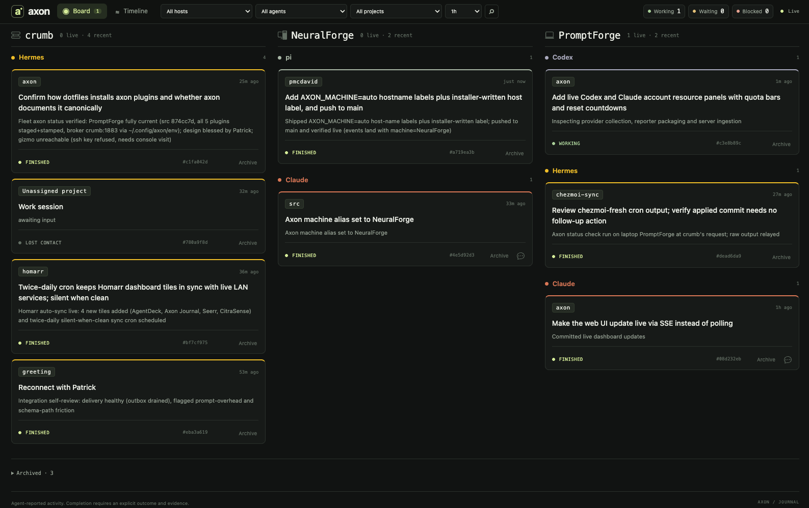

# Axon

Axon turns agent activity into a small physical status display. Its components
can run on different machines or together on one device.

- **[Server](docs/install-server.md):** stores session activity, retains history,
  and publishes the current session view. Includes a browser UI for
  live work, the event timeline, session details, and token-protected input to
  running Claude Code sessions. No display hardware required.
- **[Handset](docs/install-handset.md):** a Rust application for the PiSugar
  Whisplay display, buttons, battery, and LEDs. No journal database required.
- **[Agent plugins](docs/install-plugins.md):** self-contained Codex, Claude
  Code, Hermes, Pi, and OpenCode adapters. No server implementation bundled.
- **[Integrations](integrations/README.md):** optional Gabbie voice/relay and
  Glass status publishing. A handset works without either.

An MQTT broker connects publishers, server, and handset. Each component has its
own installation and configuration; no particular network or host is assumed.

See [architecture](docs/architecture.md), [wire contracts](protocol/README.md),
[development and release checks](docs/development.md), and the
[0.3 migration guide](docs/migration.md). This is a clean component breakout;
old source paths and superseded implementations are removed.

## Source layout

| Directory | Responsibility |
| --- | --- |
| `server/` | Journal, read API, retention, server service unit |
| `handset/native/` | Portable display core and Linux hardware binary |
| `packages/python/` | Shared validation and reporter runtime |
| `plugins/` | Native agent adapters, builder, installer |
| `clients/query/` | Standalone read-only query CLI |
| `runner/` | Host job runner pulling dashboard start jobs (#19) |
| `protocol/` | Versioned contracts and shared fixtures |
| `integrations/` | Gabbie and Glass integration instructions |
| `hardware/` | Parts and enclosure planning |
| `tools/` | Repository checks and release artifact builder |

The enclosure/hardware concept is inspired by [Pamir AI's Lapis One](https://www.pamir.ai/).
See [hardware specification](docs/SPEC.md) and [prototype notes](docs/PROTOTYPE-PWNAGOTCHI.md).
