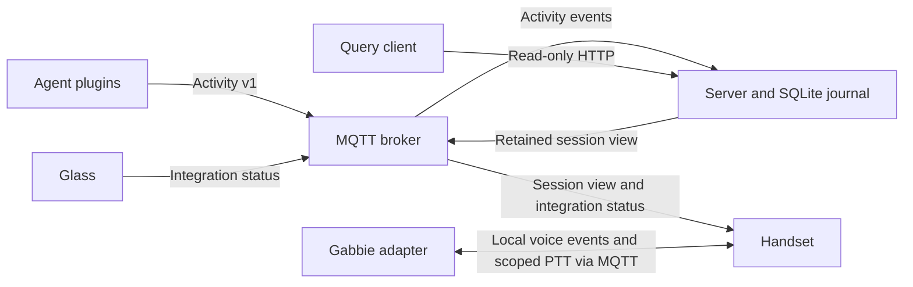

# Component architecture

## Ownership

The protocol package validates events without opening databases, connecting to a
broker, or importing the server. The reporter builds events, hashes session IDs,
and queues them in a private local outbox. Plugins translate native lifecycle
hooks and supply explicit reporting guidance. Their built artifacts carry only
protocol/reporter code.

The server owns durable history, retention, duplicate handling, current-session
projection, and lease expiry. It consumes activity events and publishes a
retained view. Its SQLite schema remains unchanged by this extraction. One
collector runs per broker; the persistent subscription ID is fixed.

The handset's library owns canvas/font rendering, display state, activity
projection, integration-status handling, configuration, and voice transitions.
The hardware binary owns GPIO/SPI, sensor polling, MQTT/HTTP transports, and
optional Gabbie connections. Pure rendering can be tested without a Raspberry Pi.
Pin and panel constants live in `handset/native/src/profile.rs`.

Gabbie owns speech and agent-message routing. Glass owns its own work. Neither is
a dependency of the server, and their source repositories are not imported here.
The query client uses only HTTP and is separately installable.

## Failure behavior

- Reporting hooks fail open; a broker outage leaves events in the local outbox.
  Later reports retry; `axon-report retry` explicitly drains queued events.
- The journal preserves history across restart and uses QoS 1 plus broker
  persistence for collector outages. Event IDs suppress duplicate delivery.
- The handset reconnects independently. Sender timestamps and leases prevent
  replayed retained data from appearing as fresh activity. Integration rows expire
  after 12 hours without a new sender timestamp.
- PTT enqueue is nonblocking: a full/disconnected publisher queue is logged
  instead of blocking physical input. Voice delivery is best-effort during a
  broker outage; the external voice service must apply its own listening timeout.
- Gabbie is disabled by default. When enabled, missing voice service retries in a
  background thread; a voice timeout returns the handset to idle.
- Neither the server read API nor the handset control API has authentication.
  Both bind to loopback by default. MQTT currently uses plain TCP without
  application-configured credentials/TLS; deploy on a trusted private network or
  behind a separately secured transport. Do not expose these listeners publicly.

## Identity and privacy

Reporter installations generate a stable random machine label in private local
state. `AXON_MACHINE` and `AXON_SOURCE` allow explicit labels; `AXON_MACHINE=auto`
resolves the host name instead. Hostnames are never read unless that label is set
explicitly, and the managed installer sets it as a deliberate opt-in. Reporters also send a coarse `machine_kind` (laptop, desktop,
or server) from local hardware facts, overridable with `AXON_MACHINE_KIND`. Session IDs are hashed. Lifecycle hooks never copy prompts,
responses, or tool arguments. Explicit goals, branch/project labels, outcomes,
and evidence are still application data: choose what to report accordingly.

No live deployment or agent settings are changed by moving the source tree.
See [migration](migration.md) for the deliberate installation break.
